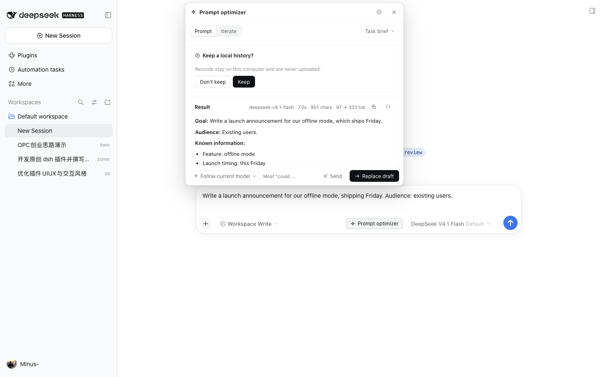

# 提示词优化器 · Prompt Optimizer

[](https://www.npmjs.com/package/@minus77/dsh-prompt-optimize) [](./LICENSE)

一个 DeepSeek Harness 插件：把输入框里的草稿改写成可直接使用的提示词。替换前先看逐行 diff，替换后 9 秒内可撤销；带本地历史、版本对比和一套可复用的模板。

[English](./README_en.md) · [模板说明](./docs/TEMPLATES.md)


## 它解决什么问题

大多数“效果不好”的提示词，问题不在模型，而在草稿本身：只说了要做什么，没给材料、交付物和边界。这个插件在**不离开输入框**的前提下，把一句口语化草稿补成结构化提示词，并且把“会不会毁掉我原来的字”这件事交给 diff 和撤销来决定。

- **不打断**：一个按钮开在输入框上方，不用切窗口、不用复制粘贴。
- **可审阅**：替换前逐行标出增删，确认后才写回草稿。
- **可回退**：写回后 9 秒内一键撤销。
- **可迭代**：对结果继续提修改意见，只改你指出的地方。
- **可留存**：历史留在这台电脑，可对比版本、随时写回。

## 功能

| 能力 | 说明 |
| --- | --- |
| 自动改写 | 打开面板即按当前草稿自动跑一次，草稿变化后可重跑 |
| 流式输出 | 文本逐段出现，可随时停止，不阻塞输入框 |
| 逐行 diff | 替换前展示 `-` / `+` 行，长文自动折叠未改动段落 |
| 9 秒撤销 | 写回草稿后底部出现撤销入口，过期自动消失 |
| 版本历史 | 本机保存最近 50 条，按版本链组织，可回写、对比、删除 |
| 版本对比 | 两栏对照原稿与结果，并给出行级结构变化统计 |
| 参数化 | 从结果中抽取可替换片段（最多 5 个），一键写成 `{{变量}}` |
| 模板库 | 7 个内置模板，按“基础 / 结构 / 示范 / 推理 / 迭代”分组 |
| 模型固定 | 默认跟随当前模型，也可在面板里指定某个模型 |
| 中英双语 | 跟随界面语言自动切换，无需单独设置 |
| 隐私优先 | 历史默认不开启，开启后只写本机 localStorage |

## 安装

要求：DeepSeek Harness `>= 0.1.7-0`，Node.js `>= 18`。

### 1. 从 npm 安装（推荐）

```bash
dsh plugin --profile web add @minus77/dsh-prompt-optimize
```

装的是 registry 上已发布的版本（[npm](https://www.npmjs.com/package/@minus77/dsh-prompt-optimize) / [Release](https://github.com/Minus77/dsh-prompt-optimize/releases)），装完直接跳到第 2 步。

<details>
<summary>离线安装：从源码或 Release 里的 tgz</summary>

```bash
git clone https://github.com/Minus77/dsh-prompt-optimize.git
cd dsh-prompt-optimize
npm pack          # 生成 minus77-dsh-prompt-optimize-0.1.0.tgz
dsh plugin --profile web add file:$PWD/minus77-dsh-prompt-optimize-0.1.0.tgz
```

</details>

### 2. 让 profile 加载它

编辑 `~/.dsh/profiles/<profile>/package.json`，把包名追加到 `dsh.profile.bundles`：

```json
{
  "dsh": {
    "profile": {
      "bundles": [
        "@deepseek-ai/dsh-base",
        "@deepseek-ai/dsh-web-app",
        "@minus77/dsh-prompt-optimize"
      ]
    }
  }
}
```

重启该 profile 的 Harness（`dsh --profile <profile>`），输入框右侧就会出现“提示词优化”。

> 用 `plugin_manager` 的 `install_bundle` 安装时，第 1、2 步会一次完成，无需手改 JSON。

### 本地开发

```bash
npm test                                   # 21 个单元测试，无需网络
dsh plugin --profile dev add file:$PWD     # 软链当前目录，改完重启即可
```

## 使用

### 打开

在输入框写好草稿，点输入框右下角的“提示词优化”。


面板会在输入框上方展开并自动改写。第一次使用时可以选择是否保留历史，选择结果会记住。

### 审阅与替换

结果读完后点“替换草稿”，先进入 diff 确认页：


确认后草稿被替换，底部出现 9 秒撤销条：


### 参数化片段

点结果右上角的变量按钮，模型会从结果里找出最多 5 个值得复用的片段，写成 `{{中文或英文名}}`：


点“写回模板”把带变量的版本写回草稿，之后每次复用只改变量值即可。

### 迭代

切到“迭代优化”，用一句话说明想改什么，例如“语气更轻松一点，把待确认的长列表收成三行”。模型只改相关段落：


### 历史与对比

顶部时钟按钮进入历史。每条记录带版本号、模板、字数变化，可展开复看、复制、写回、对比或删除：


### English UI

界面语言为英文时，插件文案、模板名和按钮全部切换：



## 模板

内置 7 个模板，按用途分组。完整说明（适用场景、结构、示例）见 [docs/TEMPLATES.md](./docs/TEMPLATES.md)。

| 模板 | 模式 | 分组 | 适合 |
| --- | --- | --- | --- |
| 任务简报 Task brief | 提示词 | 基础 | 大多数“帮我做点什么” |
| 交付契约 Delivery contract | 提示词 | 结构 | 有明确验收标准的任务 |
| 示例引导 Worked examples | 提示词 | 示范 | 风格或格式需要靠样例锁定 |
| 推理步骤 Reasoning steps | 提示词 | 推理 | 多步分析、需要中间检查 |
| 角色设定 Role contract | 系统提示词 | 基础 | 长期使用的角色约束 |
| Agent 人设 Agent persona | 系统提示词 | 基础 | 说话方式与判断习惯 |
| 增量改写 Incremental edit | 迭代 | 迭代 | 在上一版上小改 |

面板内可直接切换模板；切换后底部会出现“用新模板重跑”，不会悄悄覆盖当前结果。

## 快捷键

| 操作 | 快捷键 |
| --- | --- |
| 运行 / 重新运行 | `⌘ Enter`（Windows / Linux 为 `Ctrl Enter`） |
| 关闭面板 | `Esc`（先关菜单，再关确认页，最后关面板） |
| 停止生成 | 面板内“停止”按钮 |

## 隐私

- 历史默认关闭；开启时只写浏览器 `localStorage`，不经过网络。
- 插件只把当前草稿、迭代意见和模板内容发给当前模型，不额外上传历史。
- 关闭历史不会删除已有记录；可在历史页“清空”彻底删除。
- 面板里固定的模型只影响本插件的请求，不改变会话默认模型。

## 已知边界

- 只处理文字：暂不支持把图片附件作为改写输入。
- 单次草稿上限 60,000 字符，抽取变量最多 5 个。
- 系统提示词类模板目前只能通过内置 API 使用，界面只暴露“提示词 / 迭代”两档。
- 需要一个可用的默认模型；没有可用模型时面板会给出明确提示，而不是静默失败。

## 开发

```
src/spec.js          模板元数据与查询
src/prompts.js       各模板的提示词构造
src/placeholders.js  变量解析、定位与套用
src/catalog.js       模型与模板目录
src/index.js         宿主端路由（models / optimize / variables）
src/web.js           客户端面板（React + 主题 token）
test/                node:test 单元测试
```

- 测试：`npm test`
- 代码风格：ESM、无构建步骤、客户端不使用 JSX，全部走主题变量。
- 宿主路由：`GET /prompt-optimize/models`、`POST /prompt-optimize/optimize`（NDJSON 流）、`POST /prompt-optimize/variables`。

## 许可证

MIT。界面截图来自本机真实运行的实例。
