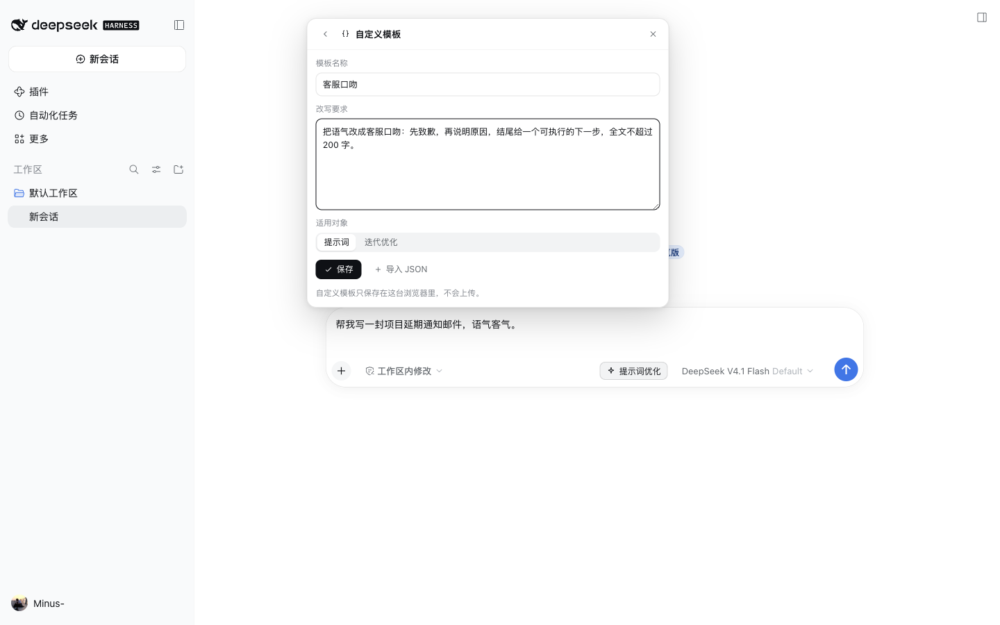

# Prompt-Optimizer

[](https://www.npmjs.com/package/@minus77/dsh-prompt-optimize) [](./LICENSE)

[中文](./README.md) · [English](./README_en.md) · [Español](./README_es.md) · [Français](./README_fr.md) · **Deutsch** · [Русский](./README_ru.md) · [日本語](./README_ja.md) · [Português (BR)](./README_pt.md)

Ein Plugin für DeepSeek Harness, das den groben Entwurf in deinem Eingabefeld zu einem Prompt macht, mit dem du tatsächlich arbeiten kannst. Bevor etwas ersetzt wird, prüfst du einen zeilenweisen Diff; danach hast du neun Sekunden Zeit für ein Undo, und das Plugin führt eine lokale Historie mit Versionsvergleich, bewertet das Ergebnis, hält eine zweite Fassung bereit und bringt 15 integrierte Vorlagen plus deine eigenen mit.

Welche Vorlage du wählst und wofür jede gedacht ist: siehe [Vorlagenanleitung](./docs/TEMPLATES.de.md).


## Warum

Die meisten Prompts, die „nicht funktionieren“, sind kein Modellproblem, sondern ein Entwurfsproblem: Die Aufgabe ist da, aber Material, Lieferergebnis und Grenzen fehlen. Dieses Plugin schließt diese Lücke, **ohne dass du das Eingabefeld verlässt**, und überlässt es dem Diff und dem Undo-Fenster, ob es deine Formulierungen anfassen darf.

- **Kein Kontextwechsel**: Ein Button am Eingabefeld öffnet ein Panel darüber.
- **Prüfbar**: Ein Zeilen-Diff zeigt die Änderungen, bevor etwas zurückgeschrieben wird.
- **Umkehrbar**: Neun Sekunden Undo nach dem Ersetzen.
- **Iterierbar**: Fordere eine Änderung am Ergebnis an; nur dieser Teil bewegt sich.
- **Lokal**: Die Historie bleibt auf diesem Rechner und ist Opt-in.

## Funktionen

| Funktion | Details |
| --- | --- |
| Automatisches Umschreiben | Beim Öffnen des Panels läuft einmal automatisch ein Durchlauf; nach Änderungen am Entwurf erneut starten |
| Streaming | Der Text erscheint schrittweise, lässt sich stoppen und blockiert das Eingabefeld nie |
| Zeilen-Diff | `-` / `+`-Zeilen vor dem Ersetzen, unveränderte Abschnitte eingeklappt |
| 9-Sekunden-Undo | Undo-Leiste nach dem Ersetzen, verschwindet von selbst |
| Historie | Die letzten 50 Durchläufe, zu Versionsketten gruppiert, wiederherstellen / vergleichen / löschen |
| Vergleich | Zwei Spalten plus eine lokale Zusammenfassung der Struktur auf Zeilenebene |
| Platzhalter | Bis zu 5 wiederverwendbare Fragmente als `{{snake_case}}`-Variablen extrahieren |
| Prüfung | Bewertet Klarheit, Kontext, Format, Vorgaben, Beispiele und Robustheit und listet Korrekturen, die du mit einem Klick anwendest |
| Zweite Fassung | Hält das vorherige Ergebnis hinter einem Chip, damit du zwischen zwei Fassungen wechseln kannst |
| Vorlagen | 15 integrierte, gruppiert als Basis / Struktur / Beispiele / Denken / Engineering / Text / Iterieren |
| Eigene Vorlagen | Schreibe deine eigene Umschreib-Anweisung, speichere sie in diesem Browser, importiere und exportiere sie als JSON |
| Modell festlegen | Dem Sitzungsmodell folgen oder eines nur für dieses Panel festlegen |
| UI in acht Sprachen | Folgt automatisch der Sprache der App (中文, English, 日本語, Español, Français, Deutsch, Русский, Português) |
| Datenschutz | Historie standardmäßig aus; wenn aktiviert, bleibt sie in `localStorage` |

## Installation

Voraussetzungen: DeepSeek Harness `>= 0.2.2-rc.5` und Node.js `>= 24.9`.

### 1. Aus npm installieren (empfohlen)

```bash
dsh plugin --profile web add @minus77/dsh-prompt-optimize
```

Damit wird das veröffentlichte Paket installiert ([npm](https://www.npmjs.com/package/@minus77/dsh-prompt-optimize) / [Release](https://github.com/Minus77/dsh-prompt-optimize/releases)); fahre danach mit Schritt 2 fort.

<details>
<summary>Offline-Installation: aus dem Quellcode oder dem Release-Tarball</summary>

```bash
git clone https://github.com/Minus77/dsh-prompt-optimize.git
cd dsh-prompt-optimize
npm pack          # produces minus77-dsh-prompt-optimize-0.4.0.tgz
dsh plugin --profile web add file:$PWD/minus77-dsh-prompt-optimize-0.4.0.tgz
```

</details>

### 2. Im Profil laden

Bearbeite `~/.dsh/profiles/<profile>/package.json` und hänge das Paket an `dsh.profile.bundles` an:

```json
{
  "dsh": {
    "profile": {
      "bundles": [
        "@deepseek-ai/dsh-base",
        "@deepseek-ai/dsh-web-app",
        "@minus77/dsh-prompt-optimize"
      ]
    }
  }
}
```

Starte das Profil neu (`dsh --profile <profile>`); rechts am Eingabefeld erscheint der Button „Prompt optimizer“.

> Wenn du mit `install_bundle` aus dem `plugin_manager` gegen dieses Repository installierst, erledigen sich beide Schritte von selbst — du musst kein JSON bearbeiten.

### Lokale Entwicklung

```bash
npm test                                   # 32 unit tests, no network
dsh plugin --profile dev add file:$PWD     # symlinked; restart to pick up edits
```

## Verwendung

### Öffnen

Schreibe einen Entwurf und klicke dann auf den Button rechts am Eingabefeld.


Das Panel öffnet sich über dem Eingabefeld und beginnt mit dem Umschreiben. Beim ersten Lauf wirst du gefragt, ob die Historie gespeichert werden soll; die Antwort wird gemerkt.

### Prüfen und ersetzen

Wenn der Stream endet, klicke auf „Replace draft“, um zuerst den Diff zu sehen:


Nach der Bestätigung wird der Entwurf ersetzt und neun Sekunden lang erscheint eine Undo-Leiste:


### Prüfung

Der Prüfbutton im Kopf des Ergebnisses ändert den Entwurf nie. Er liefert eine Gesamtnote, sechs Teilnoten und bis zu fünf nach Schwere sortierte Probleme. Jedes Problem zitiert die genaue Stelle und bietet einen Ersatz, den du direkt anwendest; der übrige Text bleibt unverändert.


### Zweite Fassung

Das Ergebnis überzeugt nicht? Drücke unten auf „Zweite Fassung“. Die vorherige Fassung wandert hinter den Chip, und du kannst zwischen beiden wechseln; Zeichenzahl, Dauer und Token-Verbrauch folgen der aktiven Fassung.


### Eigene Vorlagen

Der letzte Eintrag im Vorlagenmenü ist „Neue eigene Vorlage“: Name, Umschreib-Anweisung und Zielgruppe eintragen. Danach erscheint sie neben den integrierten. Eigene Vorlagen liegen nur im localStorage dieses Browsers; für den Umzug auf einen anderen Rechner dienen JSON-Import und -Export.



### Platzhalter

Klicke auf die geschweiften Klammern am Ergebnis. Das Modell findet bis zu fünf wiederverwendbare Fragmente und schreibt sie als `{{variables}}` um:


„Write back“ schreibt die parametrisierte Version zurück ins Eingabefeld, sodass Wiederverwendung nur noch das Ändern von Werten bedeutet.

### Iterieren

Wechsle zu „Iterate“ und beschreibe eine Änderung, z. B. „mach den Ton lockerer und fasse die Liste der offenen Punkte in drei Zeilen zusammen“. Nur die betroffenen Passagen ändern sich:


### Historie und Vergleich

Der Uhr-Button öffnet die Historie. Jede Zeile zeigt Version, Vorlage und Zeichen-Delta und lässt sich aufklappen, um zu kopieren, wiederherzustellen, zu vergleichen oder zu löschen:


### Chinesische Oberfläche

Bei chinesischer Oberflächensprache sind dasselbe Panel, dieselben Vorlagen und dieselben Buttons lokalisiert:


## Vorlagen

Fünfzehn integrierte Vorlagen, nach Zweck gruppiert. Die vollständigen Beschreibungen stehen in [docs/TEMPLATES.de.md](./docs/TEMPLATES.de.md).

| Vorlage | Modus | Gruppe | Geeignet für |
| --- | --- | --- | --- |
| Task brief | Prompt | Basis | Die meisten Entwürfe der Art „hilf mir, X zu machen“ |
| Delivery contract | Prompt | Struktur | Arbeit mit expliziten Abnahmekriterien |
| Structured extraction | Prompt | Struktur | Feste Felder verlässlich aus Material ziehen |
| Worked examples | Prompt | Beispiele | Stil oder Format, das durch Beispiele festgelegt wird |
| Reasoning steps | Prompt | Denken | Mehrstufige Analyse mit Zwischenprüfungen |
| Grounded Q&A | Prompt | Denken | Aus dem Material antworten, mit Belegen |
| Code review | Prompt | Engineering | Eine abgegrenzte, priorisierte Durchsicht |
| Implementation task | Prompt | Engineering | Codearbeit mit Abnahme, Schnittstellen und Randfällen |
| SQL query | Prompt | Engineering | Kennzahlen, Felder und Leistungsgrenzen |
| Test design | Prompt | Engineering | Fälle für Normalfall, Grenze, Fehler und Rechte |
| Translation | Prompt | Text | Zielgruppe, Glossar und Format |
| Copy polish | Prompt | Text | Wie weit die Überarbeitung gehen darf |
| Role contract | System | Basis | Langlebige Rollenvorgaben |
| Agent persona | System | Basis | Tonfall und Urteilsgewohnheiten |
| Incremental edit | Iterate | Iterieren | Kleine Änderungen auf einer bestehenden Version |

Vorlagen lassen sich im Panel wechseln; die Fußzeile bietet dann „rerun with new template“ an, statt das aktuelle Ergebnis still zu überschreiben. Dasselbe Menü erlaubt eigene Vorlagen sowie JSON-Import und -Export.

## Tastenkürzel

| Aktion | Taste |
| --- | --- |
| Ausführen / erneut ausführen | `⌘ Enter` (`Ctrl Enter` unter Windows/Linux) |
| Schließen | `Esc` (Menü → Diff-Prüfung → Panel) |
| Stoppen | „Stop“ im Panel |

## Datenschutz

- Die Historie ist standardmäßig aus; wenn sie aktiviert ist, wird sie ausschließlich im `localStorage` des Browsers gespeichert.
- Das Plugin sendet den aktuellen Entwurf, die Iterationsnotiz und den Vorlageninhalt an das aktuelle Modell — niemals deine Historie.
- Schaltest du die Historie aus, bleiben bestehende Einträge erhalten; „Clear“ löscht sie.
- Ein festgelegtes Modell betrifft nur die Anfragen dieses Plugins, nicht den Standard der Sitzung.

## Bekannte Grenzen

- Nur Text: Bildanhänge werden noch nicht als Eingabe für das Umschreiben akzeptiert.
- 60.000 Zeichen pro Entwurf; höchstens 5 extrahierte Variablen.
- Vorlagen für System-Prompts gibt es in der API, das Panel zeigt aber nur Prompt und Iterate.
- Die Prüfung diagnostiziert nur: Sie schreibt den Entwurf nicht neu, und ein Zitat muss 10–80 Zeichen lang sein, daher können sehr kurze Entwürfe keine auffindbaren Probleme liefern.
- Eigene Vorlagen bleiben im localStorage dieses Browsers; für den Umzug JSON verwenden.
- Ein Standardmodell ist erforderlich; das Panel meldet das klar, statt still zu scheitern.

## Entwicklung

```
src/spec.js          template metadata and queries
src/prompts.js       prompt construction per template
src/placeholders.js  variable parsing, anchoring and application
src/review.js        checkup parsing, validation and normalization
src/catalog.js       model and template catalog
src/index.js         host routes (models / optimize / variables / review)
src/web.js           client panel (React + theme tokens)
test/                node:test unit tests
```

- Tests: `npm test`
- ESM, kein Build-Schritt, kein JSX im Client; alle Farben stammen aus `--dsw-alias-*`-Tokens.
- Host-Routen: `GET /prompt-optimize/models`, `POST /prompt-optimize/optimize` (NDJSON), `POST /prompt-optimize/variables`, `POST /prompt-optimize/review`.

## Lizenz

MIT. Die Screenshots stammen von einer echten, auf diesem Rechner laufenden Instanz.
