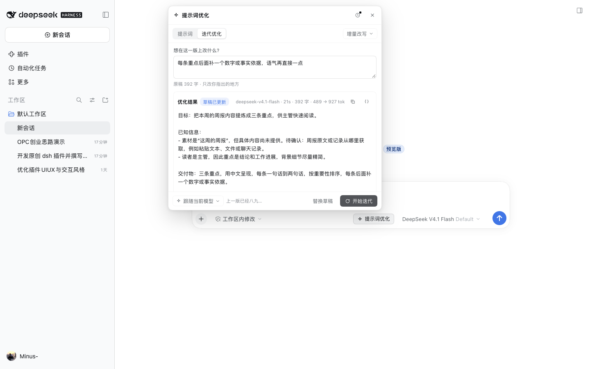

# Prompt Optimizer

[](https://www.npmjs.com/package/@minus77/dsh-prompt-optimize) [](./LICENSE)

A DeepSeek Harness plugin that turns the rough draft in your composer into a prompt you can actually use. You review a line-by-line diff before it replaces anything, you can undo for nine seconds afterwards, and it keeps a local history with version compare and a library of reusable templates.

[中文](./README.md) · [Templates](./docs/TEMPLATES.en.md)


## Why

Most prompts that "don't work" are not a model problem — they are a draft problem: the ask is there, but the material, the deliverable and the boundaries are not. This plugin fills that gap **without leaving the composer**, and it lets the diff and the undo window decide whether it is allowed to touch your words.

- **No context switch**: a seat button opens a panel above the composer.
- **Reviewable**: a line diff shows what changes before anything is written back.
- **Reversible**: nine seconds of undo after replacing.
- **Iterable**: ask for a change on the result; only that part moves.
- **Local**: history stays on this machine, and it is opt-in.

## Features

| Capability | Detail |
| --- | --- |
| Auto rewrite | Opening the panel runs once automatically; rerun after the draft changes |
| Streaming | Text arrives incrementally, can be stopped, never blocks the composer |
| Line diff | `-` / `+` rows before replacing, unchanged runs collapsed |
| 9-second undo | Undo bar after replacing, expires on its own |
| History | Last 50 runs, grouped into version chains, replay / compare / delete |
| Compare | Two columns plus a local, line-level structure summary |
| Placeholders | Extract up to 5 reusable fragments into `{{snake_case}}` variables |
| Templates | 7 built-ins grouped as basic / structure / examples / reasoning / iterate |
| Model pin | Follow the session model, or pin one for this panel only |
| Bilingual | Follows the app locale automatically |
| Privacy | History off by default; when on, it stays in `localStorage` |

## Install

Requires DeepSeek Harness `>= 0.1.7-0` and Node.js `>= 18`.

### 1. Install from npm (recommended)

```bash
dsh plugin --profile web add @minus77/dsh-prompt-optimize
```

That pulls the published package ([npm](https://www.npmjs.com/package/@minus77/dsh-prompt-optimize) / [release](https://github.com/Minus77/dsh-prompt-optimize/releases)); then continue with step 2.

<details>
<summary>Offline install: from source or the release tarball</summary>

```bash
git clone https://github.com/Minus77/dsh-prompt-optimize.git
cd dsh-prompt-optimize
npm pack          # produces minus77-dsh-prompt-optimize-0.1.0.tgz
dsh plugin --profile web add file:$PWD/minus77-dsh-prompt-optimize-0.1.0.tgz
```

</details>

### 2. Load it in that profile

Edit `~/.dsh/profiles/<profile>/package.json` and append the package to `dsh.profile.bundles`:

```json
{
  "dsh": {
    "profile": {
      "bundles": [
        "@deepseek-ai/dsh-base",
        "@deepseek-ai/dsh-web-app",
        "@minus77/dsh-prompt-optimize"
      ]
    }
  }
}
```

Restart that profile (`dsh --profile <profile>`); the "Prompt optimizer" seat appears on the right side of the composer.

> Installing with `plugin_manager`'s `install_bundle` against this repository does both steps for you — no JSON editing.

### Local development

```bash
npm test                                   # 21 unit tests, no network
dsh plugin --profile dev add file:$PWD     # symlinked; restart to pick up edits
```

## Usage

### Open

Write a draft, then click the seat at the right of the composer.


The panel opens above the composer and starts rewriting. The first run asks whether to keep history; the answer is remembered.

### Review and replace

When the stream ends, click "Replace draft" to see the diff first:


After confirming, the draft is replaced and an undo bar appears for nine seconds:


### Placeholders

Click the braces button on the result. The model finds up to five reusable fragments and rewrites them as `{{variables}}`:


"Write back" puts the parameterized version into the composer, so reuse only means changing values.

### Iterate

Switch to "Iterate" and describe one change, e.g. "make the tone lighter and collapse the pending list into three lines". Only the relevant passages move:



### History and compare

The clock button opens history. Each row shows version, template and character delta, and expands to copy, restore, compare or delete:


### Chinese UI

With a Chinese locale the same panel, templates and buttons are localized:


## Templates

Seven built-ins, grouped by intent. Full descriptions live in [docs/TEMPLATES.en.md](./docs/TEMPLATES.en.md).

| Template | Mode | Group | Use for |
| --- | --- | --- | --- |
| Task brief | Prompt | Basic | Most "help me do X" drafts |
| Delivery contract | Prompt | Structure | Work with explicit acceptance criteria |
| Worked examples | Prompt | Examples | Style or format pinned by samples |
| Reasoning steps | Prompt | Reasoning | Multi-step analysis with checkpoints |
| Role contract | System | Basic | Long-lived role constraints |
| Agent persona | System | Basic | Voice and judgment habits |
| Incremental edit | Iterate | Iterate | Small changes on top of a version |

Templates can be switched inside the panel; the footer then offers "rerun with new template" instead of silently overwriting the current result.

## Shortcuts

| Action | Key |
| --- | --- |
| Run / rerun | `⌘ Enter` (`Ctrl Enter` on Windows/Linux) |
| Close | `Esc` (menu → diff review → panel) |
| Stop | "Stop" in the panel |

## Privacy

- History is off by default; when enabled it is written to browser `localStorage` only.
- The plugin sends the current draft, the iterate note and template content to the current model — never your history.
- Turning history off keeps existing rows; "Clear" deletes them.
- Pinning a model affects this plugin's requests only, not the session default.

## Known limits

- Text only: image attachments are not accepted as rewrite input yet.
- 60,000 characters per draft; at most 5 extracted variables.
- System-prompt templates exist in the API but the panel exposes only Prompt and Iterate.
- A default model is required; the panel reports it clearly instead of failing silently.

## Development

```
src/spec.js          template metadata and queries
src/prompts.js       prompt construction per template
src/placeholders.js  variable parsing, anchoring and application
src/catalog.js       model and template catalog
src/index.js         host routes (models / optimize / variables)
src/web.js           client panel (React + theme tokens)
test/                node:test unit tests
```

- Tests: `npm test`
- ESM, no build step, no JSX on the client; all colors come from `--dsw-alias-*` tokens.
- Host routes: `GET /prompt-optimize/models`, `POST /prompt-optimize/optimize` (NDJSON), `POST /prompt-optimize/variables`.

## License

MIT. Screenshots were captured from a real running instance on this machine.
