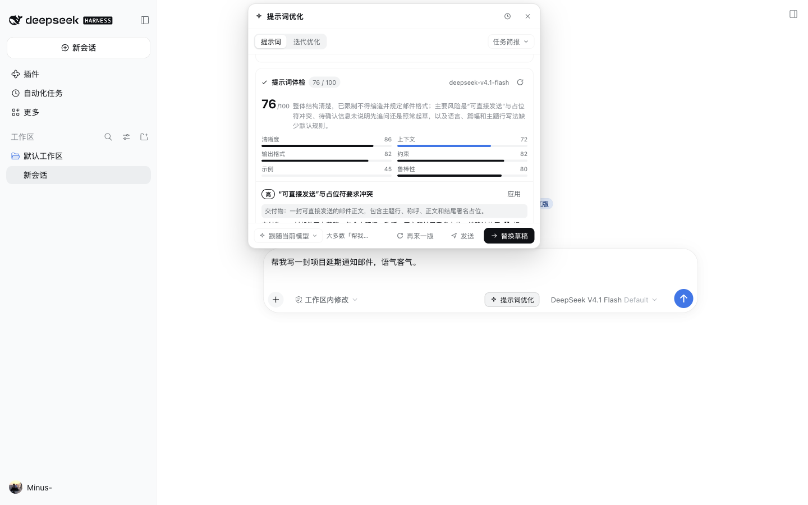
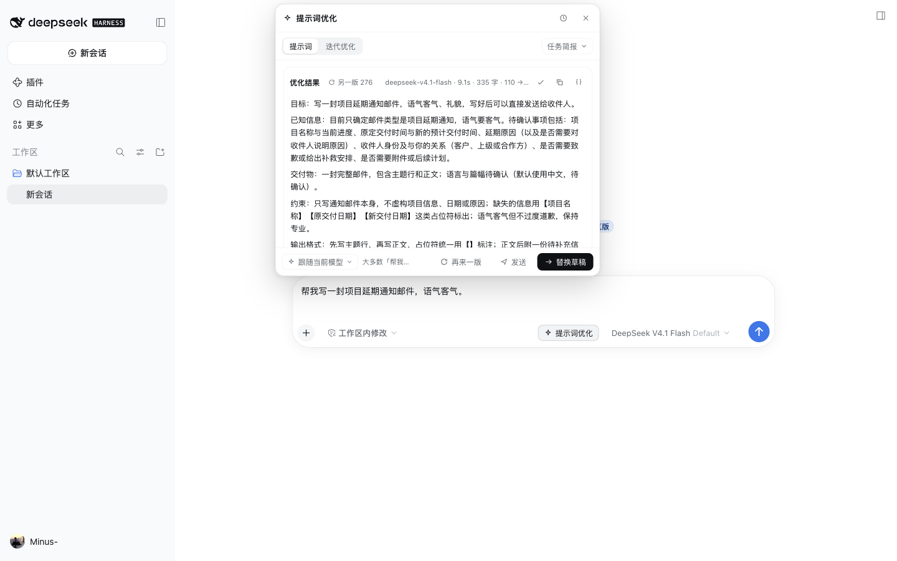
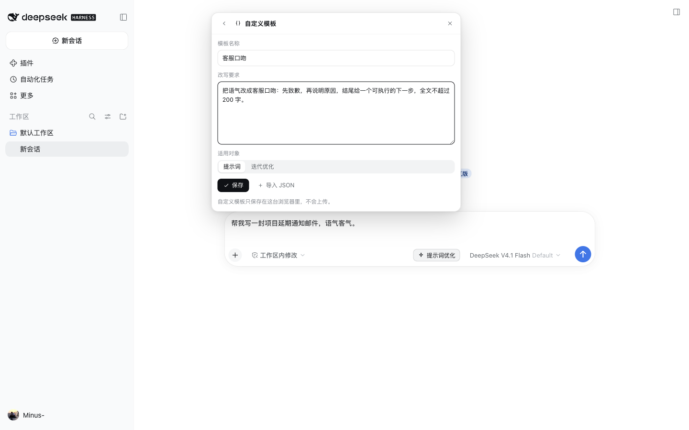

# Optimizador de prompts

[](https://www.npmjs.com/package/@minus77/dsh-prompt-optimize) [](./LICENSE)

[中文](./README.md) · [English](./README_en.md) · **Español** · [Français](./README_fr.md) · [Deutsch](./README_de.md) · [Русский](./README_ru.md) · [日本語](./README_ja.md)

Un plugin de DeepSeek Harness que convierte el borrador aproximado de tu compositor en un prompt que de verdad puedes usar. Revisas un diff línea a línea antes de que sustituya nada, puedes deshacer durante nueve segundos después, y guarda un historial local con comparación de versiones, puntúa el resultado, conserva una segunda versión y trae 15 plantillas integradas más las tuyas.

Para saber qué plantilla elegir y para qué sirve cada una, consulta la [guía de plantillas](./docs/TEMPLATES.es.md).


## Por qué

La mayoría de los prompts que “no funcionan” no son un problema del modelo, sino del borrador: el encargo está, pero faltan los materiales, el entregable y los límites. Este plugin cubre ese hueco **sin salir del compositor**, y deja que el diff y la ventana de deshacer decidan si puede tocar tus palabras.

- **Sin cambio de contexto**: un botón en la barra del compositor abre un panel justo encima.
- **Revisable**: un diff por líneas muestra qué cambia antes de que se escriba nada de vuelta.
- **Reversible**: nueve segundos de deshacer tras el reemplazo.
- **Iterable**: pide un cambio sobre el resultado; solo se mueve esa parte.
- **Local**: el historial se queda en esta máquina y es opcional.

## Funciones

| Capacidad | Detalle |
| --- | --- |
| Reescritura automática | Abrir el panel lanza una pasada automática; vuelve a lanzarla si cambia el borrador |
| Streaming | El texto llega de forma incremental, se puede detener y nunca bloquea el compositor |
| Diff por líneas | Filas `-` / `+` antes de reemplazar, con los tramos sin cambios plegados |
| Deshacer en 9 s | Barra de deshacer después de reemplazar, que caduca sola |
| Historial | Últimas 50 ejecuciones, agrupadas en cadenas de versiones; reproducir / comparar / borrar |
| Comparar | Dos columnas y un resumen local de la estructura a nivel de línea |
| Marcadores | Extrae hasta 5 fragmentos reutilizables como variables `{{snake_case}}` |
| Revisión | Puntúa claridad, contexto, formato, restricciones, ejemplos y robustez, y lista correcciones aplicables con un clic |
| Otra versión | Guarda el resultado anterior detrás de una pestaña para alternar entre dos versiones |
| Plantillas | 15 integradas, agrupadas como básicas / estructura / ejemplos / razonamiento / ingeniería / redacción / iteración |
| Plantillas propias | Escribe tu propia instrucción de reescritura, guárdala en este navegador e impórtala o expórtala en JSON |
| Fijar modelo | Sigue el modelo de la sesión o fija uno solo para este panel |
| Interfaz bilingüe (zh/en) | Sigue el idioma de la aplicación automáticamente |
| Privacidad | Historial desactivado por defecto; si se activa, se queda en `localStorage` |

## Instalación

Requiere DeepSeek Harness `>= 0.2.2-rc.5` y Node.js `>= 24.9`.

### 1. Instalar desde npm (recomendado)

```bash
dsh plugin --profile web add @minus77/dsh-prompt-optimize
```

Eso descarga el paquete publicado ([npm](https://www.npmjs.com/package/@minus77/dsh-prompt-optimize) / [release](https://github.com/Minus77/dsh-prompt-optimize/releases)); después continúa con el paso 2.

<details>
<summary>Instalación sin conexión: desde el código fuente o el tarball de la release</summary>

```bash
git clone https://github.com/Minus77/dsh-prompt-optimize.git
cd dsh-prompt-optimize
npm pack          # produces minus77-dsh-prompt-optimize-0.2.0.tgz
dsh plugin --profile web add file:$PWD/minus77-dsh-prompt-optimize-0.2.0.tgz
```

</details>

### 2. Cárgalo en ese perfil

Edita `~/.dsh/profiles/<profile>/package.json` y añade el paquete a `dsh.profile.bundles`:

```json
{
  "dsh": {
    "profile": {
      "bundles": [
        "@deepseek-ai/dsh-base",
        "@deepseek-ai/dsh-web-app",
        "@minus77/dsh-prompt-optimize"
      ]
    }
  }
}
```

Reinicia ese perfil (`dsh --profile <profile>`); el botón “Prompt optimizer” aparece a la derecha del compositor.

> Si instalas con `install_bundle` de `plugin_manager` contra este repositorio, hace los dos pasos por ti: sin editar JSON.

### Desarrollo local

```bash
npm test                                   # 32 unit tests, no network
dsh plugin --profile dev add file:$PWD     # symlinked; restart to pick up edits
```

## Uso

### Abrir

Escribe un borrador y pulsa el botón a la derecha del compositor.


El panel se abre encima del compositor y empieza a reescribir. La primera vez pregunta si quieres guardar el historial; la respuesta se recuerda.

### Revisar y reemplazar

Cuando termina el streaming, pulsa “Replace draft” para ver primero el diff:


Al confirmar, el borrador se sustituye y aparece una barra de deshacer durante nueve segundos:


### Revisión

El botón de revisión de la cabecera del resultado nunca edita el borrador. Devuelve una puntuación total, seis puntuaciones por dimensión y hasta cinco problemas ordenados por gravedad. Cada problema cita el fragmento exacto y ofrece un reemplazo que puedes aplicar en el sitio; el resto del texto no se toca.



### Otra versión

¿No te convence el resultado? Pulsa "Otra versión" en el pie. La versión anterior pasa detrás de la pestaña "otra versión" y puedes alternar entre ambas; el recuento de caracteres, el tiempo y el uso de tokens siguen a la versión activa.



### Plantillas

Quince plantillas integradas, agrupadas por intención. Las descripciones completas están en [docs/TEMPLATES.es.md](./docs/TEMPLATES.es.md).

| Plantilla | Modo | Grupo | Sirve para |
| --- | --- | --- | --- |
| Task brief | Prompt | Básico | La mayoría de borradores del tipo "ayúdame con X" |
| Delivery contract | Prompt | Estructura | Trabajo con criterios de aceptación explícitos |
| Structured extraction | Prompt | Estructura | Sacar campos fijos de un material |
| Worked examples | Prompt | Ejemplos | Estilo o formato fijado por ejemplos |
| Reasoning steps | Prompt | Razonamiento | Análisis en varios pasos con controles |
| Grounded Q&A | Prompt | Razonamiento | Responder desde el material, con citas |
| Code review | Prompt | Ingeniería | Una revisión acotada y priorizada |
| Implementation task | Prompt | Ingeniería | Trabajo de código con aceptación e interfaces |
| SQL query | Prompt | Ingeniería | Definición de métricas, campos y rendimiento |
| Test design | Prompt | Ingeniería | Casos normales, límite, error y permisos |
| Translation | Prompt | Redacción | Audiencia, glosario y formato |
| Copy polish | Prompt | Redacción | Hasta dónde puede llegar la edición |
| Role contract | System | Básico | Restricciones de rol de larga duración |
| Agent persona | System | Básico | Voz y hábitos de criterio |
| Incremental edit | Iterate | Iterar | Cambios pequeños sobre una versión |

Las plantillas se cambian dentro del panel; el pie ofrece entonces "rerun with new template" en lugar de sobrescribir el resultado en silencio. El mismo menú permite crear una plantilla propia e importarla o exportarla en JSON.

### Plantillas propias

El último elemento del menú abre el editor: nombre, consigna de reescritura y para qué borradores sirve. La plantilla se guarda solo en el `localStorage` de este navegador y no se sube a ningún sitio; para llevarla a otro equipo o compartirla, usa «Exportar JSON» e «Importar JSON» del mismo editor.



## Atajos

| Acción | Tecla |
| --- | --- |
| Ejecutar / volver a ejecutar | `⌘ Enter` (`Ctrl Enter` en Windows/Linux) |
| Cerrar | `Esc` (menú → revisión del diff → panel) |
| Detener | “Stop” en el panel |

## Privacidad

- El historial está desactivado por defecto; si lo activas, solo se escribe en el `localStorage` del navegador.
- El plugin envía al modelo actual el borrador en curso, la nota de iteración y el contenido de la plantilla; nunca tu historial.
- Desactivar el historial conserva las filas existentes; “Clear” las borra.
- Fijar un modelo solo afecta a las peticiones de este plugin, no al modelo por defecto de la sesión.

## Límites conocidos

- Solo texto: de momento no se aceptan imágenes adjuntas como entrada para reescribir.
- 60.000 caracteres por borrador; como máximo 5 variables extraídas.
- Las plantillas de system prompt existen en la API, pero el panel solo expone Prompt e Iterate.
- La revisión solo diagnostica: no reescribe el borrador, y un fragmento debe tener entre 10 y 80 caracteres para citarse, así que los borradores muy cortos pueden no dar problemas localizables.
- Las plantillas propias se quedan en el localStorage de este navegador; usa JSON para moverlas.
- Se necesita un modelo por defecto; el panel lo indica con claridad en lugar de fallar en silencio.

## Desarrollo

```
src/spec.js          template metadata and queries
src/prompts.js       prompt construction per template
src/placeholders.js  variable parsing, anchoring and application
src/review.js        checkup parsing, validation and normalization
src/catalog.js       model and template catalog
src/index.js         host routes (models / optimize / variables / review)
src/web.js           client panel (React + theme tokens)
test/                node:test unit tests
```

- Pruebas: `npm test`
- ESM, sin paso de compilación y sin JSX en el cliente; todos los colores vienen de los tokens `--dsw-alias-*`.
- Rutas del host: `GET /prompt-optimize/models`, `POST /prompt-optimize/optimize` (NDJSON), `POST /prompt-optimize/variables`, `POST /prompt-optimize/review`.

## Licencia

MIT. Las capturas se tomaron de una instancia real en ejecución en esta máquina.
