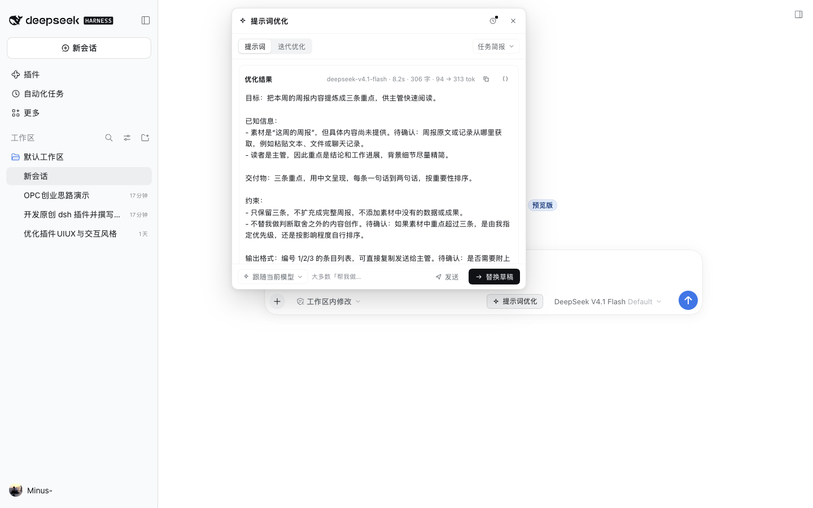
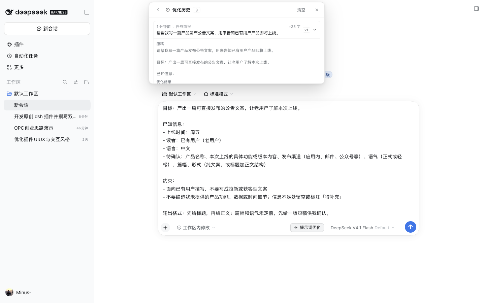
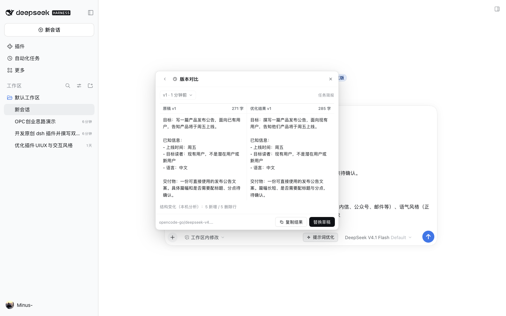

# Optimiseur de prompts

[](https://www.npmjs.com/package/@minus77/dsh-prompt-optimize) [](./LICENSE)

[中文](./README.md) · [English](./README_en.md) · [Español](./README_es.md) · **Français** · [Deutsch](./README_de.md) · [Русский](./README_ru.md) · [日本語](./README_ja.md)

Un plugin DeepSeek Harness qui transforme le brouillon approximatif de votre zone de saisie en un prompt réellement utilisable. Vous relisez un diff ligne par ligne avant tout remplacement, vous pouvez annuler pendant neuf secondes ensuite, et le plugin conserve un historique local avec comparaison de versions et une bibliothèque de modèles réutilisables.

Pour savoir quel modèle choisir et à quoi sert chacun, voir le [guide des modèles](./docs/TEMPLATES.fr.md).



## Pourquoi

La plupart des prompts qui « ne fonctionnent pas » ne relèvent pas d'un problème de modèle, mais d'un problème de brouillon : la demande est là, mais le matériau, le livrable et les limites manquent. Ce plugin comble cet écart **sans quitter la zone de saisie**, et il laisse le diff et la fenêtre d'annulation décider s'il peut toucher à vos mots.

- **Aucun changement de contexte** : un bouton ouvre un panneau au-dessus de la zone de saisie.
- **Vérifiable** : un diff ligne à ligne montre ce qui change avant toute réécriture.
- **Réversible** : neuf secondes d'annulation après le remplacement.
- **Itérable** : demandez une modification sur le résultat ; seule cette partie bouge.
- **Local** : l'historique reste sur cette machine, et son activation est facultative.

## Fonctionnalités

| Capacité | Détail |
| --- | --- |
| Réécriture automatique | L'ouverture du panneau lance une passe automatique ; relancez après modification du brouillon |
| Flux en continu | Le texte arrive par fragments, peut être interrompu, ne bloque jamais la zone de saisie |
| Diff ligne à ligne | Lignes `-` / `+` avant remplacement, passages inchangés repliés |
| Annulation 9 secondes | Barre d'annulation après remplacement, expiration automatique |
| Historique | Les 50 dernières exécutions, groupées en chaînes de versions, rejouer / comparer / supprimer |
| Comparaison | Deux colonnes plus un résumé de structure local, au niveau des lignes |
| Espaces réservés | Extraire jusqu'à 5 fragments réutilisables en variables `{{snake_case}}` |
| Modèles | 7 modèles intégrés, groupés en basique / structure / exemples / raisonnement / itération |
| Modèle figé | Suivre le modèle de la session, ou en figer un pour ce panneau uniquement |
| Interface bilingue (zh/en) | Suit automatiquement la langue de l'application |
| Confidentialité | Historique désactivé par défaut ; s'il est activé, il reste dans `localStorage` |

## Installation

Nécessite DeepSeek Harness `>= 0.1.7-0` et Node.js `>= 18`.

### 1. Installation depuis npm (recommandé)

```bash
dsh plugin --profile web add @minus77/dsh-prompt-optimize
```

Cette commande récupère le paquet publié ([npm](https://www.npmjs.com/package/@minus77/dsh-prompt-optimize) / [release](https://github.com/Minus77/dsh-prompt-optimize/releases)) ; passez ensuite à l'étape 2.

<details>
<summary>Installation hors ligne : depuis les sources ou l'archive de release</summary>

```bash
git clone https://github.com/Minus77/dsh-prompt-optimize.git
cd dsh-prompt-optimize
npm pack          # produces minus77-dsh-prompt-optimize-0.1.0.tgz
dsh plugin --profile web add file:$PWD/minus77-dsh-prompt-optimize-0.1.0.tgz
```

</details>

### 2. Chargement dans ce profil

Modifiez `~/.dsh/profiles/<profile>/package.json` et ajoutez le paquet à `dsh.profile.bundles` :

```json
{
  "dsh": {
    "profile": {
      "bundles": [
        "@deepseek-ai/dsh-base",
        "@deepseek-ai/dsh-web-app",
        "@minus77/dsh-prompt-optimize"
      ]
    }
  }
}
```

Redémarrez ce profil (`dsh --profile <profile>`) ; le bouton « Prompt optimizer » apparaît à droite de la zone de saisie.

> Installer avec `install_bundle` de `plugin_manager` depuis ce dépôt effectue les deux étapes à votre place — aucune modification JSON.

### Développement local

```bash
npm test                                   # 21 unit tests, no network
dsh plugin --profile dev add file:$PWD     # symlinked; restart to pick up edits
```

## Utilisation

### Ouvrir

Rédigez un brouillon, puis cliquez sur le bouton à droite de la zone de saisie.


Le panneau s'ouvre au-dessus de la zone de saisie et lance la réécriture. La première exécution demande si vous souhaitez conserver l'historique ; la réponse est mémorisée.

### Relire et remplacer

À la fin du flux, cliquez sur « Replace draft » pour afficher d'abord le diff :


Après confirmation, le brouillon est remplacé et une barre d'annulation apparaît pendant neuf secondes :


### Espaces réservés

Cliquez sur le bouton d'accolades du résultat. Le modèle repère jusqu'à cinq fragments réutilisables et les réécrit en `{{variables}}` :


« Write back » place la version paramétrée dans la zone de saisie : réutiliser revient donc simplement à changer les valeurs.

### Itérer

Passez sur « Iterate » et décrivez une modification, par exemple « allège le ton et condense la liste des éléments en attente en trois lignes ». Seuls les passages concernés bougent :


### Historique et comparaison

Le bouton d'horloge ouvre l'historique. Chaque ligne indique la version, le modèle de prompt utilisé et l'écart de caractères, et se déplie pour copier, restaurer, comparer ou supprimer :





### Interface chinoise

Avec une locale chinoise, le panneau, les modèles et les boutons sont également localisés :


## Modèles

Sept modèles intégrés, groupés par intention. Les descriptions complètes se trouvent dans [docs/TEMPLATES.fr.md](./docs/TEMPLATES.fr.md).

| Modèle | Mode | Groupe | Usage |
| --- | --- | --- | --- |
| Task brief | Prompt | Basique | La plupart des brouillons « aide-moi à faire X » |
| Delivery contract | Prompt | Structure | Travaux avec critères d'acceptation explicites |
| Worked examples | Prompt | Exemples | Style ou format fixé par des exemples |
| Reasoning steps | Prompt | Raisonnement | Analyse en plusieurs étapes avec points de contrôle |
| Role contract | System | Basique | Contraintes de rôle durables |
| Agent persona | System | Basique | Voix et habitudes de jugement |
| Incremental edit | Iterate | Itération | Petites modifications par-dessus une version existante |

Les modèles se changent dans le panneau ; le pied de panneau propose alors « rerun with new template » au lieu d'écraser silencieusement le résultat courant.

## Raccourcis

| Action | Touche |
| --- | --- |
| Exécuter / relancer | `⌘ Enter` (`Ctrl Enter` sous Windows/Linux) |
| Fermer | `Esc` (menu → relecture du diff → panneau) |
| Arrêter | « Stop » dans le panneau |

## Confidentialité

- L'historique est désactivé par défaut ; une fois activé, il n'est écrit que dans le `localStorage` du navigateur.
- Le plugin envoie au modèle de langage courant le brouillon en cours, la note d'itération et le contenu du modèle — jamais votre historique.
- Désactiver l'historique conserve les entrées existantes ; « Clear » les supprime.
- Figer un modèle n'affecte que les requêtes de ce plugin, pas le modèle par défaut de la session.

## Limites connues

- Texte uniquement : les pièces jointes image ne sont pas encore acceptées comme entrée de réécriture.
- 60 000 caractères par brouillon ; au maximum 5 variables extraites.
- Les modèles de type system prompt existent dans l'API, mais le panneau n'expose que Prompt et Iterate.
- Un modèle par défaut est requis ; le panneau l'indique clairement au lieu d'échouer en silence.

## Développement

```
src/spec.js          template metadata and queries
src/prompts.js       prompt construction per template
src/placeholders.js  variable parsing, anchoring and application
src/catalog.js       model and template catalog
src/index.js         host routes (models / optimize / variables)
src/web.js           client panel (React + theme tokens)
test/                node:test unit tests
```

- Tests : `npm test`
- ESM, aucune étape de build, pas de JSX côté client ; toutes les couleurs viennent des tokens `--dsw-alias-*`.
- Routes côté hôte : `GET /prompt-optimize/models`, `POST /prompt-optimize/optimize` (NDJSON), `POST /prompt-optimize/variables`.

## Licence

MIT. Les captures d'écran proviennent d'une instance réellement en cours d'exécution sur cette machine.
