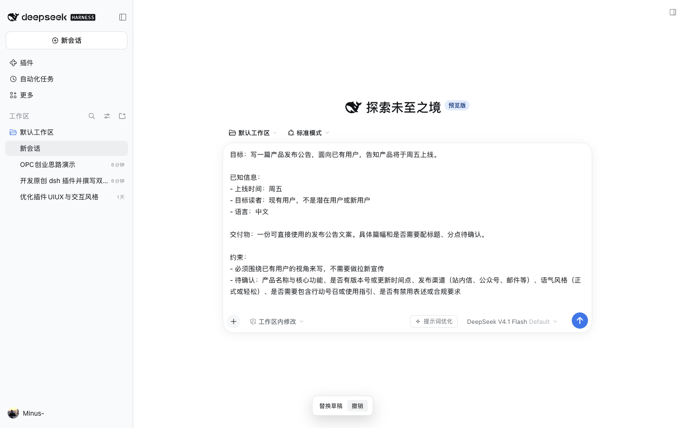
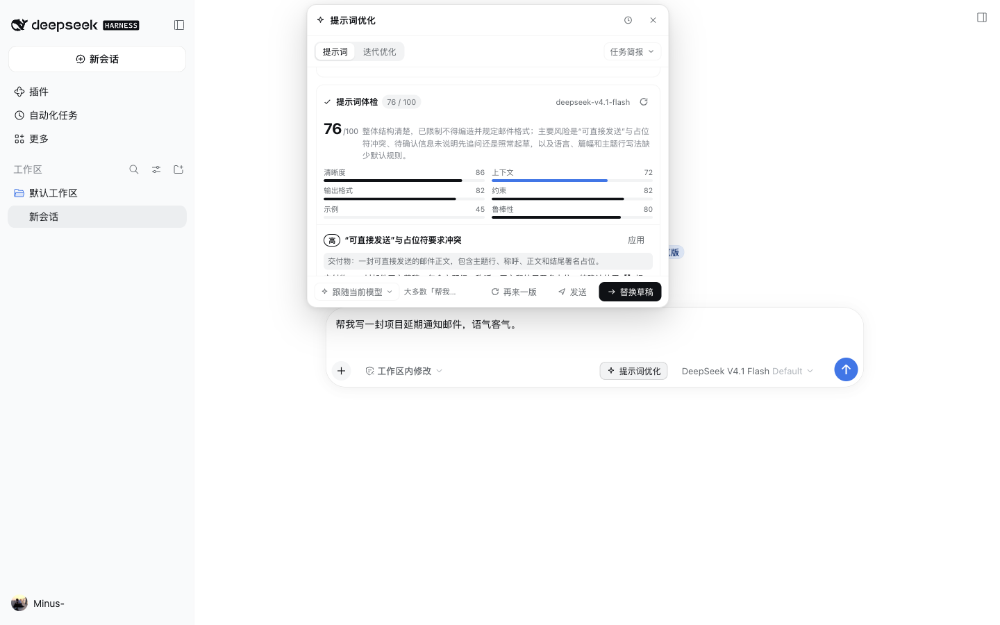
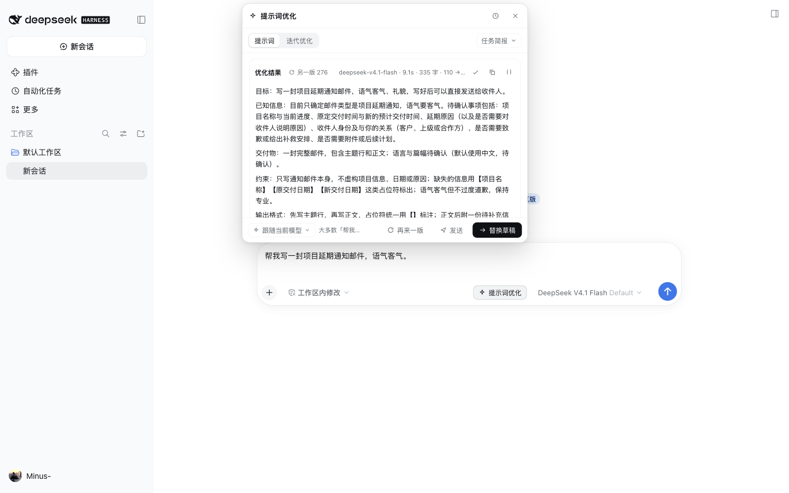
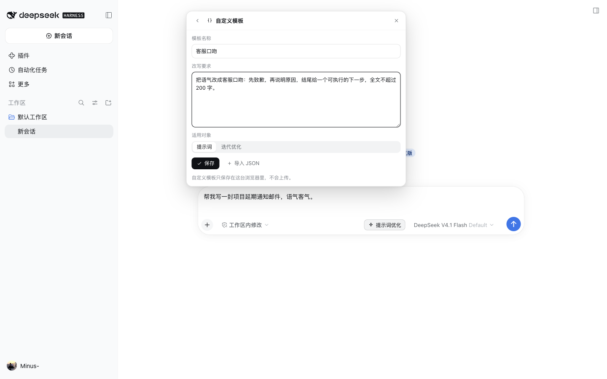

# Otimizador de prompts

[](https://www.npmjs.com/package/@minus77/dsh-prompt-optimize) [](./LICENSE)

[中文](./README.md) · [English](./README_en.md) · [Español](./README_es.md) · [Français](./README_fr.md) · [Deutsch](./README_de.md) · [Русский](./README_ru.md) · [日本語](./README_ja.md) · **Português (BR)**

Um plugin do DeepSeek Harness que transforma o rascunho solto do seu campo de entrada em um prompt que você pode realmente usar. Você revisa um diff linha a linha antes de qualquer substituição, pode desfazer por nove segundos depois disso, e ele mantém um histórico local com comparação de versões, pontua o resultado, guarda uma segunda versão e traz 15 modelos embutidos além dos seus próprios.

Qual modelo escolher, e para que serve cada um: veja [o guia de modelos](./docs/TEMPLATES.pt.md).


## Por quê

A maioria dos prompts que "não funcionam" não é um problema de modelo — é um problema de rascunho: o pedido está lá, mas o material, a entrega e os limites não estão. Este plugin preenche essa lacuna **sem sair do campo de entrada**, e deixa o diff e a janela de desfazer decidirem se ele pode ou não mexer nas suas palavras.

- **Sem troca de contexto**: um botão abre um painel acima do campo de entrada.
- **Revisável**: um diff linha a linha mostra o que muda antes de qualquer coisa ser gravada de volta.
- **Reversível**: nove segundos de desfazer após a substituição.
- **Iterável**: peça uma alteração no resultado; só aquela parte muda.
- **Local**: o histórico fica nesta máquina e é opcional.

## Recursos

| Recurso | Detalhe |
| --- | --- |
| Reescrita automática | Abrir o painel executa uma vez automaticamente; execute de novo depois que o rascunho mudar |
| Streaming | O texto chega aos poucos, pode ser interrompido, nunca bloqueia o campo de entrada |
| Diff por linha | Linhas `-` / `+` antes de substituir, trechos inalterados recolhidos |
| Desfazer em 9 segundos | Barra de desfazer após substituir, expira sozinha |
| Histórico | As últimas 50 execuções, agrupadas em cadeias de versões, reproduzir / comparar / excluir |
| Comparação | Duas colunas mais um resumo local da estrutura em nível de linha |
| Placeholders | Extrai até 5 trechos reutilizáveis em variáveis `{{snake_case}}` |
| Revisão | Pontua clareza, contexto, formato, restrições, exemplos e robustez, e então lista correções que você aplica com um clique |
| Outra versão | Mantém o resultado anterior atrás de um chip para você alternar entre duas versões |
| Modelos | 15 embutidos agrupados como básico / estrutura / exemplos / raciocínio / engenharia / escrita / iteração |
| Modelos personalizados | Escreva sua própria instrução de reescrita, salve-a neste navegador, importe e exporte como JSON |
| Fixar modelo | Segue o modelo da sessão, ou fixa um só para este painel |
| Interface em oito idiomas | Segue o idioma do app automaticamente (中文, English, 日本語, Español, Français, Deutsch, Русский, Português) |
| Privacidade | Histórico desativado por padrão; quando ativado, fica em `localStorage` |

## Instalação

Requer DeepSeek Harness `>= 0.2.2-rc.5` e Node.js `>= 24.9`.

### 1. Instalar pelo npm (recomendado)

```bash
dsh plugin --profile web add @minus77/dsh-prompt-optimize
```

Isso baixa o pacote publicado ([npm](https://www.npmjs.com/package/@minus77/dsh-prompt-optimize) / [release](https://github.com/Minus77/dsh-prompt-optimize/releases)); depois siga para o passo 2.

<details>
<summary>Instalação offline: a partir do código-fonte ou do tarball da release</summary>

```bash
git clone https://github.com/Minus77/dsh-prompt-optimize.git
cd dsh-prompt-optimize
npm pack          # produces minus77-dsh-prompt-optimize-0.4.0.tgz
dsh plugin --profile web add file:$PWD/minus77-dsh-prompt-optimize-0.4.0.tgz
```

</details>

### 2. Carregá-lo nesse perfil

Edite `~/.dsh/profiles/<profile>/package.json` e acrescente o pacote a `dsh.profile.bundles`:

```json
{
  "dsh": {
    "profile": {
      "bundles": [
        "@deepseek-ai/dsh-base",
        "@deepseek-ai/dsh-web-app",
        "@minus77/dsh-prompt-optimize"
      ]
    }
  }
}
```

Reinicie esse perfil (`dsh --profile <profile>`); o botão "Prompt optimizer" aparece no lado direito do campo de entrada.

> Instalar com o `install_bundle` do `plugin_manager` apontando para este repositório faz os dois passos por você — sem editar JSON.

### Desenvolvimento local

```bash
npm test                                   # 21 unit tests, no network
dsh plugin --profile dev add file:$PWD     # symlinked; restart to pick up edits
```

## Uso

### Abrir

Escreva um rascunho e clique no botão à direita do campo de entrada.


O painel abre acima do campo de entrada e começa a reescrever. A primeira execução pergunta se o histórico deve ser mantido; a resposta fica memorizada.

### Revisar e substituir

Quando o streaming termina, clique em "Substituir rascunho" para ver o diff primeiro:


Depois de confirmar, o rascunho é substituído e uma barra de desfazer aparece por nove segundos:



### Revisão

O botão de revisão no cabeçalho do resultado nunca edita o rascunho. Ele informa uma pontuação total, seis pontuações por dimensão e até cinco problemas ordenados por severidade. Cada problema cita o trecho exato e oferece uma substituição que você pode aplicar no local; o restante do texto permanece intacto.



### Outra versão

Não gostou de um resultado? Pressione "Outra versão" no rodapé. A versão anterior vai para trás do chip "outra versão", e as duas podem ser alternadas; contagem de caracteres, tempo decorrido e uso de tokens acompanham a versão ativa.



### Modelos personalizados

O último item do menu de modelos é "Novo modelo personalizado": dê a ele um nome, uma instrução de reescrita e para quem ele serve. Depois ele aparece ao lado dos embutidos. Modelos personalizados ficam apenas no localStorage deste navegador — use a importação/exportação JSON para levá-los entre máquinas.



### Placeholders

Clique no botão de chaves no resultado. O modelo encontra até cinco trechos reutilizáveis e os reescreve como `{{variables}}`:


"Escrever de volta" coloca a versão parametrizada no campo de entrada, então reutilizar significa apenas trocar os valores.

### Iterar

Mude para "Iterar" e descreva uma alteração, por exemplo "deixe o tom mais leve e reduza a lista de pendências a três linhas". Apenas os trechos relevantes mudam:


### Histórico e comparação

O botão de relógio abre o histórico. Cada linha mostra versão, modelo e variação de caracteres, e expande para copiar, restaurar, comparar ou excluir:


### Interface em chinês

Com um locale chinês, o mesmo painel, os modelos e os botões são localizados:


## Modelos

Quinze modelos embutidos, agrupados por intenção. As descrições completas estão em [docs/TEMPLATES.pt.md](./docs/TEMPLATES.pt.md).

| Modelo | Modo | Grupo | Use para |
| --- | --- | --- | --- |
| Resumo da tarefa | Prompt | Básico | A maioria dos rascunhos do tipo "me ajude a fazer X" |
| Contrato de entrega | Prompt | Estrutura | Trabalho com critérios de aceitação explícitos |
| Extração estruturada | Prompt | Estrutura | Extrair campos fixos de um material com confiabilidade |
| Exemplos resolvidos | Prompt | Exemplos | Estilo ou formato fixado por amostras |
| Passos de raciocínio | Prompt | Raciocínio | Análise em várias etapas com pontos de verificação |
| Perguntas e respostas fundamentadas | Prompt | Raciocínio | Responder a partir do material fornecido, com citações |
| Revisão de código | Prompt | Engenharia | Um pedido de revisão com escopo e prioridades |
| Tarefa de implementação | Prompt | Engenharia | Trabalho de código com aceitação, interfaces e casos de borda |
| Consulta SQL | Prompt | Engenharia | Definições de métricas, campos e limites de desempenho |
| Design de testes | Prompt | Engenharia | Casos cobrindo normal, limite, falha e permissões |
| Tradução | Prompt | Escrita | Público, glossário e regras de formatação |
| Polimento de texto | Prompt | Escrita | Até onde as edições podem ir, e nada de conteúdo inventado |
| Contrato de papel | System | Básico | Restrições de papel duradouras |
| Persona do agente | System | Básico | Voz e hábitos de julgamento |
| Edição incremental | Iterate | Iteração | Pequenas mudanças sobre uma versão |

Os modelos podem ser trocados dentro do painel; o rodapé então oferece "executar de novo com o novo modelo" em vez de sobrescrever silenciosamente o resultado atual. O mesmo menu também permite criar um modelo personalizado e importá-lo ou exportá-lo como JSON.

## Atalhos

| Ação | Tecla |
| --- | --- |
| Executar / executar de novo | `⌘ Enter` (`Ctrl Enter` no Windows/Linux) |
| Fechar | `Esc` (menu → revisão de diff → painel) |
| Parar | "Parar" no painel |

## Privacidade

- O histórico fica desativado por padrão; quando ativado, é gravado apenas no `localStorage` do navegador.
- O plugin envia o rascunho atual, a nota de iteração e o conteúdo do modelo ao modelo atual — nunca o seu histórico.
- Desativar o histórico mantém as linhas existentes; "Limpar" apaga todas.
- Fixar um modelo afeta apenas as requisições deste plugin, não o padrão da sessão.

## Limites conhecidos

- Apenas texto: anexos de imagem ainda não são aceitos como entrada de reescrita.
- 60.000 caracteres por rascunho; no máximo 5 variáveis extraídas.
- Modelos de prompt de sistema existem na API, mas o painel expõe apenas Prompt e Iterate.
- A revisão apenas diagnostica: nunca reescreve o rascunho inteiro, e um trecho precisa ter de 10 a 80 caracteres para ser citado, então rascunhos muito curtos podem não gerar problemas localizáveis.
- Modelos personalizados ficam no localStorage deste navegador; use a importação/exportação JSON para movê-los.
- Um modelo padrão é obrigatório; o painel informa isso claramente em vez de falhar em silêncio.

## Desenvolvimento

```
src/spec.js          template metadata and queries
src/prompts.js       prompt construction per template
src/placeholders.js  variable parsing, anchoring and application
src/review.js        checkup parsing, validation and normalization
src/catalog.js       model and template catalog
src/index.js         host routes (models / optimize / variables / review)
src/web.js           client panel (React + theme tokens)
test/                node:test unit tests
```

- Testes: `npm test`
- ESM, sem etapa de build, sem JSX no cliente; todas as cores vêm de tokens `--dsw-alias-*`.
- Rotas do host: `GET /prompt-optimize/models`, `POST /prompt-optimize/optimize` (NDJSON), `POST /prompt-optimize/variables`, `POST /prompt-optimize/review`.

## Licença

MIT. As capturas de tela foram feitas de uma instância real em execução nesta máquina.
