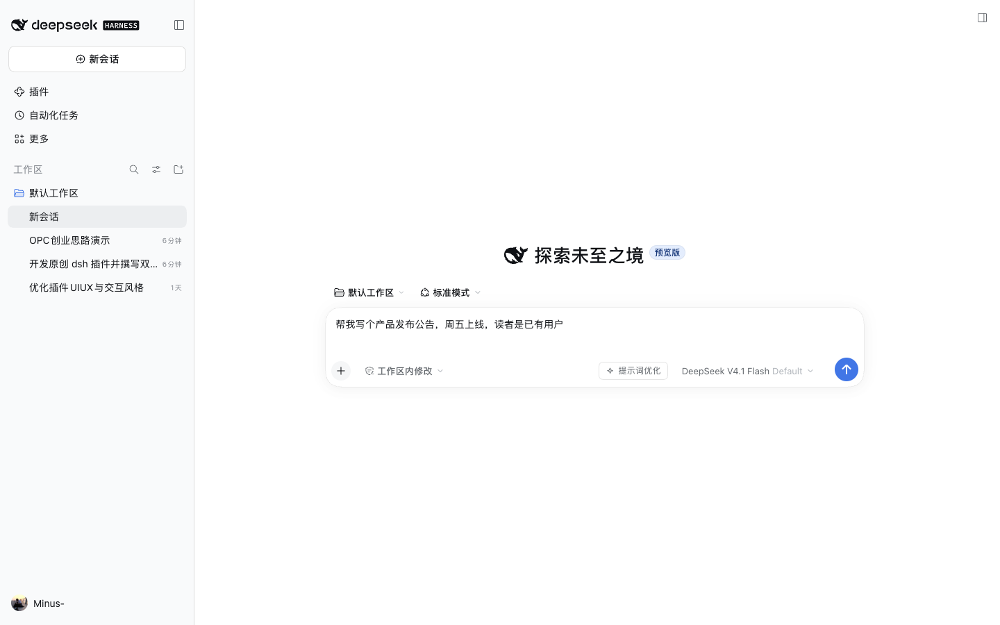
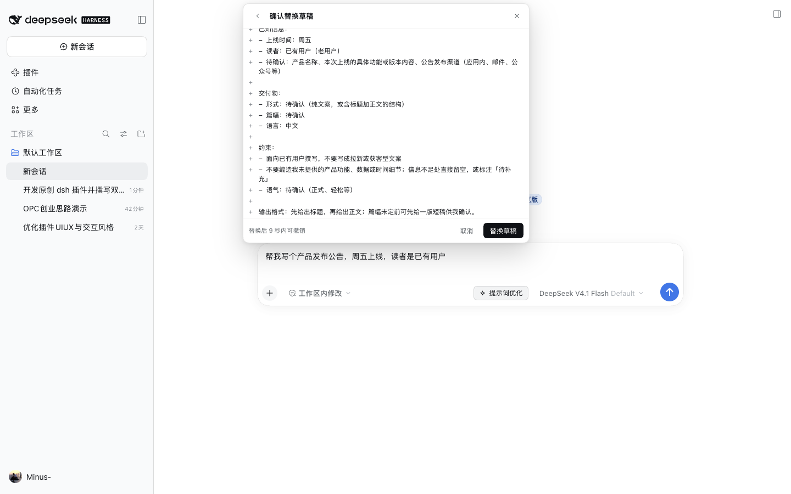

# Оптимизатор промптов

[](https://www.npmjs.com/package/@minus77/dsh-prompt-optimize) [](./LICENSE)

[中文](./README.md) · [English](./README_en.md) · [Español](./README_es.md) · [Français](./README_fr.md) · [Deutsch](./README_de.md) · **Русский** · [日本語](./README_ja.md)

Плагин для DeepSeek Harness, который превращает черновик из поля ввода в промпт, которым действительно можно пользоваться. Перед заменой вы смотрите построчный diff, после замены девять секунд остаётся на отмену, а локальная история хранит цепочки версий со сравнением и библиотеку переиспользуемых шаблонов.

Какой шаблон выбрать и для чего нужен каждый: см. [руководство по шаблонам](./docs/TEMPLATES.ru.md).


## Зачем

Большинство промптов, которые «не работают», — это проблема не модели, а черновика: просьба есть, а материала, результата и границ нет. Плагин закрывает этот разрыв, **не заставляя уходить из поля ввода**, и оставляет за diff и окном отмены право решать, можно ли трогать ваши слова.

- **Без переключения контекста**: кнопка плагина открывает панель над полем ввода.
- **С проверкой**: построчный diff показывает, что изменится, ещё до записи обратно.
- **С откатом**: девять секунд на отмену после замены.
- **С итерациями**: попросите изменить результат — сдвинется только указанная часть.
- **Локально**: история остаётся на этой машине и включается по желанию.

## Возможности

| Возможность | Подробности |
| --- | --- |
| Автоматическая перезапись | Открытие панели запускает один прогон автоматически; после изменения черновика можно запустить снова |
| Потоковый вывод | Текст приходит постепенно, его можно остановить; поле ввода не блокируется |
| Построчный diff | Строки `-` / `+` перед заменой, неизменённые фрагменты свёрнуты |
| Отмена за 9 секунд | Панель отмены после замены, исчезает сама |
| История | Последние 50 прогонов, сгруппированы в цепочки версий, повтор / сравнение / удаление |
| Сравнение | Две колонки плюс локальная построчная сводка структуры |
| Плейсхолдеры | До 5 переиспользуемых фрагментов выносятся в переменные `{{snake_case}}` |
| Шаблоны | 7 встроенных, сгруппированы как Basic / Structure / Examples / Reasoning / Iterate |
| Фиксация модели | Следовать модели сессии или закрепить свою только для этой панели |
| Двуязычный интерфейс (zh/en) | Автоматически следует языку приложения |
| Приватность | История по умолчанию выключена; при включении остаётся в `localStorage` |

## Установка

Требуются DeepSeek Harness `>= 0.1.7-0` и Node.js `>= 18`.

### 1. Установка из npm (рекомендуется)

```bash
dsh plugin --profile web add @minus77/dsh-prompt-optimize
```

Так ставится опубликованный пакет ([npm](https://www.npmjs.com/package/@minus77/dsh-prompt-optimize) / [release](https://github.com/Minus77/dsh-prompt-optimize/releases)); дальше переходите к шагу 2.

<details>
<summary>Установка офлайн: из исходников или tgz из релиза</summary>

```bash
git clone https://github.com/Minus77/dsh-prompt-optimize.git
cd dsh-prompt-optimize
npm pack          # produces minus77-dsh-prompt-optimize-0.1.0.tgz
dsh plugin --profile web add file:$PWD/minus77-dsh-prompt-optimize-0.1.0.tgz
```

</details>

### 2. Подключение в этом profile

Откройте `~/.dsh/profiles/<profile>/package.json` и добавьте пакет в `dsh.profile.bundles`:

```json
{
  "dsh": {
    "profile": {
      "bundles": [
        "@deepseek-ai/dsh-base",
        "@deepseek-ai/dsh-web-app",
        "@minus77/dsh-prompt-optimize"
      ]
    }
  }
}
```

Перезапустите Harness с этим profile (`dsh --profile <profile>`) — справа от поля ввода появится кнопка «Prompt optimizer».

> Установка через `install_bundle` из `plugin_manager` из этого репозитория делает оба шага за вас — править JSON не нужно.

### Локальная разработка

```bash
npm test                                   # 21 unit tests, no network
dsh plugin --profile dev add file:$PWD     # symlinked; restart to pick up edits
```

## Использование

### Открытие

Напишите черновик и нажмите кнопку справа от поля ввода.



Панель раскрывается над полем ввода и начинает переписывать. При первом запуске она спрашивает, сохранять ли историю; ответ запоминается.

### Проверка и замена

Когда поток закончится, нажмите «Replace draft», чтобы сначала увидеть diff:



После подтверждения черновик заменяется, а внизу на девять секунд появляется панель отмены:


### Плейсхолдеры

Нажмите кнопку с фигурными скобками на результате. Модель найдёт до пяти переиспользуемых фрагментов и перепишет их как `{{variables}}`:


«Write back» записывает версию с переменными в поле ввода, так что при повторном использовании остаётся только менять значения.

### Итерации

Переключитесь на «Iterate» и опишите одно изменение, например: «сделай тон легче и уложи длинный список пунктов к уточнению в три строки». Изменятся только нужные фрагменты:


### История и сравнение

Кнопка с часами открывает историю. В каждой строке видны версия, шаблон и изменение числа символов; строка раскрывается, чтобы скопировать, восстановить, сравнить или удалить запись:


### Китайский интерфейс

При китайской локали та же панель, шаблоны и кнопки локализованы:


## Шаблоны

Семь встроенных шаблонов, сгруппированных по назначению. Полные описания — в [docs/TEMPLATES.ru.md](./docs/TEMPLATES.ru.md).

| Шаблон | Режим | Группа | Для чего |
| --- | --- | --- | --- |
| Task brief | Prompt | Basic | Большинство черновиков вида «помоги сделать X» |
| Delivery contract | Prompt | Structure | Работа с явными критериями приёмки |
| Worked examples | Prompt | Examples | Стиль или формат заданы образцами |
| Reasoning steps | Prompt | Reasoning | Многошаговый анализ с контрольными точками |
| Role contract | System | Basic | Долгоживущие ограничения роли |
| Agent persona | System | Basic | Манера речи и привычки суждения |
| Incremental edit | Iterate | Iterate | Небольшие правки поверх версии |

Шаблоны переключаются прямо в панели; тогда внизу появляется «rerun with new template» вместо молчаливой перезаписи текущего результата.

## Горячие клавиши

| Действие | Клавиши |
| --- | --- |
| Запуск / повторный запуск | `⌘ Enter` (`Ctrl Enter` в Windows/Linux) |
| Закрытие | `Esc` (меню → просмотр diff → панель) |
| Остановка | «Stop» в панели |

## Приватность

- История по умолчанию выключена; если её включить, она пишется только в браузерный `localStorage`.
- Плагин отправляет модели текущий черновик, замечание для итерации и содержимое шаблона — но никогда вашу историю.
- Выключение истории сохраняет уже записанные строки; «Clear» удаляет их.
- Закрепление модели влияет только на запросы этого плагина, а не на модель сессии по умолчанию.

## Известные ограничения

- Только текст: вложения-изображения пока не принимаются как входные данные для переписывания.
- 60 000 символов на черновик; не более 5 извлечённых переменных.
- Шаблоны системных промптов есть в API, но панель открывает только «Prompt» и «Iterate».
- Нужна модель по умолчанию; панель сообщает об этом явно, а не падает молча.

## Разработка

```
src/spec.js          template metadata and queries
src/prompts.js       prompt construction per template
src/placeholders.js  variable parsing, anchoring and application
src/catalog.js       model and template catalog
src/index.js         host routes (models / optimize / variables)
src/web.js           client panel (React + theme tokens)
test/                node:test unit tests
```

- Тесты: `npm test`
- ESM, без шага сборки, без JSX на клиенте; все цвета берутся из токенов `--dsw-alias-*`.
- Маршруты хоста: `GET /prompt-optimize/models`, `POST /prompt-optimize/optimize` (NDJSON), `POST /prompt-optimize/variables`.

## Лицензия

MIT. Скриншоты сняты с реально запущенного экземпляра на этой машине.
